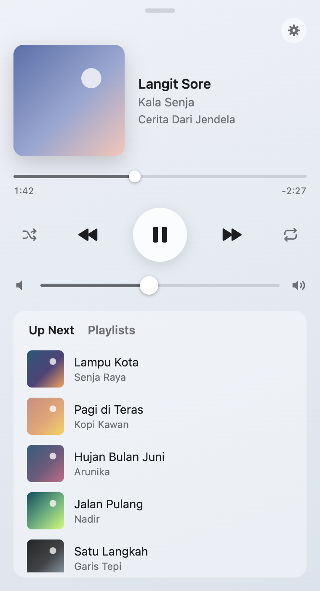
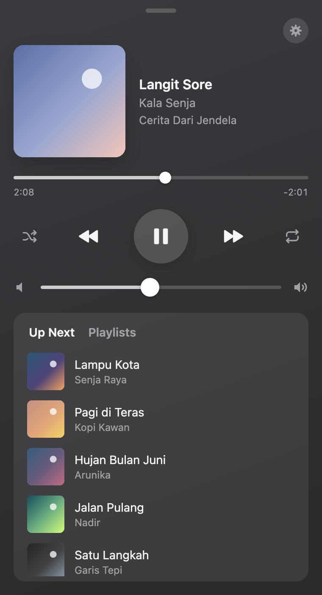
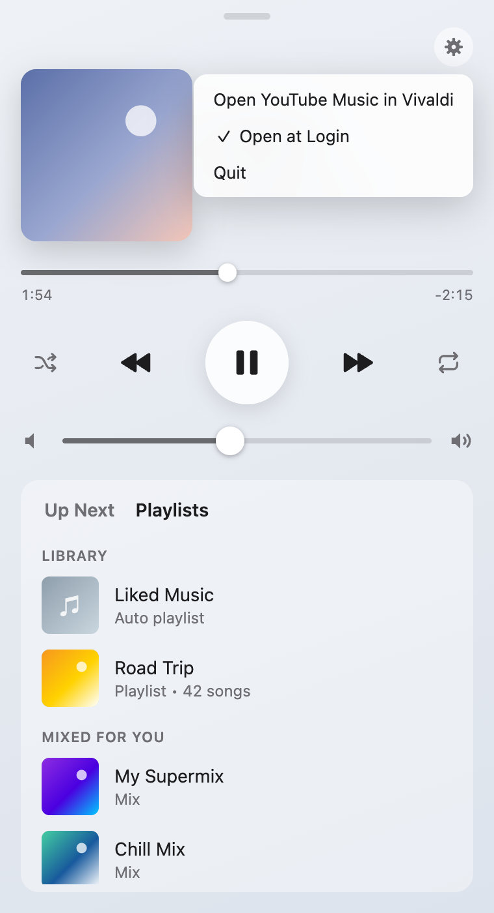
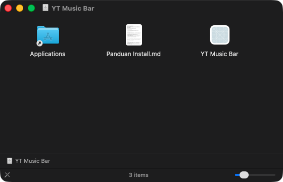
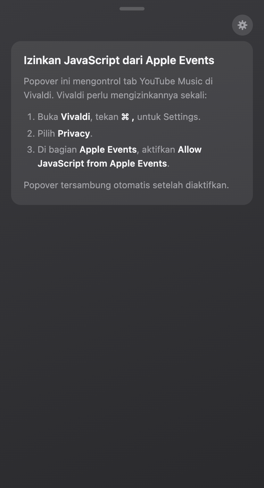

# YT Music Bar

Remote YouTube Music di menubar macOS, ditulis dengan Rust. Klik **♫** di menubar untuk
melihat lagu yang sedang diputar, mengatur pemutaran, volume, antrean, dan playlist —
tanpa perlu membuka jendela browser.

Musik tetap diputar di tab [music.youtube.com](https://music.youtube.com) di **Vivaldi**,
jadi akun, playlist, dan YouTube Premium kamu langsung terpakai tanpa login ulang.

<p align="center">
  
  
  
</p>

> Screenshot memakai data contoh (judul karangan, cover gradien).

## Fitur

- Judul lagu tampil langsung di menubar: `♫ Judul — Artis`
- Cover, judul, artis, album, dan progress yang bisa digeser (seek)
- Play/pause, previous, next, shuffle, repeat (off → all → one)
- Slider volume
- **Up Next**: daftar lagu berikutnya, klik untuk langsung memutar
- **Playlists**: playlist di Library plus playlist/mix/album dari halaman Home
- Ikut tema terang/gelap macOS, efek kaca (vibrancy)
- **Open at Login** dari menu ⚙
- Panduan langsung di popover bila izin belum aktif

## Install (DMG)

<p align="center"></p>

1. Unduh `YT-Music-Bar-<versi>.dmg` dari halaman
   [Releases](https://github.com/simenglabs/youtube-music-mac/releases).
2. Buka DMG, seret **YT Music Bar** ke **Applications**.
3. Buka app. Karena belum ditandatangani Apple, izinkan lewat
   **System Settings › Privacy & Security › Open Anyway**, atau:
   ```sh
   xattr -dr com.apple.quarantine "/Applications/YT Music Bar.app"
   ```
4. Di Vivaldi: **Settings › Privacy › Apple Events** → aktifkan
   **Allow JavaScript from Apple Events**.
5. Buka music.youtube.com di Vivaldi, putar lagu, lalu klik **♫**. Saat macOS bertanya
   *"YT Music Bar wants to control Vivaldi"*, klik **Allow**.

<p align="center"></p>

Panduan lengkap (update, uninstall, masalah umum): **[INSTALL.md](INSTALL.md)**.

## Cara kerja

```
menubar ♫ ──klik──▶ popover (webview, src/popover.html)
                        │ IPC: "play", "seek:42", "playlist:3", …
                        ▼
                    Rust (src/main.rs) ──osascript──▶ Vivaldi
                                                      └─ execute javascript di tab
                                                         music.youtube.com
```

- App tidak memutar audio sendiri dan tidak mengunduh stream. Ia hanya menekan tombol
  dan membaca tampilan pemutar YouTube Music di tab Vivaldi lewat AppleScript.
- Status dibaca tiap 1 detik saat popover terbuka, tiap 3 detik saat tertutup
  (untuk judul di menubar).
- Perintah dari popover dibatasi ke daftar tetap (whitelist) dan angka; teks dari
  YouTube ditampilkan sebagai teks biasa, bukan HTML.

## Build dari source

Butuh Rust (edisi 2024) dan Xcode Command Line Tools.

```sh
cargo run --release              # jalankan langsung
YT_MUSIC_OPEN=1 cargo run        # popover langsung terbuka dan tidak auto-tutup
cargo test                       # unit test
./build-dmg.sh                   # app universal (arm64 + x86_64) → dist/*.dmg
```

`build-dmg.sh` butuh target `aarch64-apple-darwin` dan `x86_64-apple-darwin`
(`rustup target add aarch64-apple-darwin x86_64-apple-darwin`).

## Keterbatasan

- **Hanya Vivaldi.** Chrome, Brave, dan Edge memakai AppleScript yang sama — cukup ganti
  `BROWSER_ID` di `src/main.rs`. Safari butuh perubahan kecil (`do JavaScript`).
- **Mengubah urutan atau menghapus lagu dari antrean belum bisa.** Menu per lagu di
  YouTube Music tidak bisa dibuka dari luar.
- **Gambar di Up Next kadang kosong (♪).** YouTube Music baru memuat gambar antrean
  saat panel antrean terlihat. Buka halaman player di tab Vivaldi sekali agar gambar
  termuat.
- **Playlist rekomendasi** hanya muncul selama tab YouTube Music menampilkan Home.
- Bergantung pada struktur halaman YouTube Music. Bila YouTube mengubah tampilan,
  selector di `TAB_JS` (`src/main.rs`) perlu diperbarui.
- App ditandatangani ad-hoc, belum di-notarize Apple.

## Lisensi & catatan

Proyek pribadi, tidak berafiliasi dengan Google atau YouTube. YouTube Music adalah merek
dagang Google LLC.
